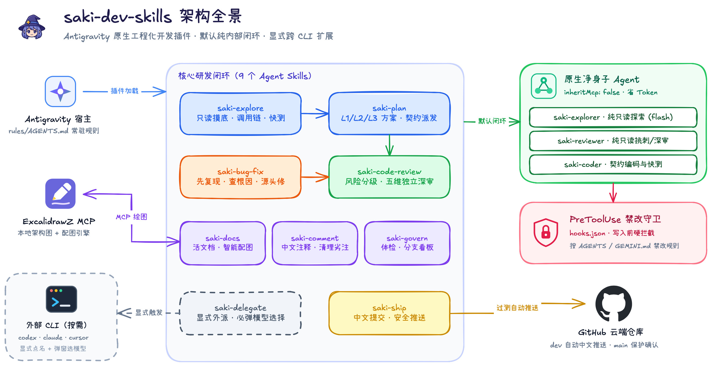

<div align="center">


<h1>Saki Dev Skills</h1>

<p><strong>Antigravity-Native Engineering Plugin &amp; Agent Skills Toolkit</strong></p>

<p>
  9 Core Agent Skills · 3 MCP-Stripped Native Subagents · ExcalidrawZ MCP Diagramming · PreToolUse Do-Not-Edit Guard · Internal-First Loop with Explicit Cross-CLI Delegation
</p>

<p>
  <a href="README.md">简体中文</a> ·
  <strong>English</strong> ·
  <a href="#installation">Installation</a> ·
  <a href="#usage-guide">Usage</a> ·
  <a href="#architecture-overview">Architecture</a> ·
  <a href="https://github.com/Yuyushu2499/saki-dev-skills/issues">Issues</a>
</p>

<p>
  <a href="plugin.json"></a>
  
  
  
  <a href="LICENSE"></a>
  <a href="https://github.com/oil-oil/oil-dev-skills"></a>
</p>

</div>

---

## Architecture Overview

<p align="center">
  
</p>

<p align="center">
  <sub>Created with ExcalidrawZ MCP · Editable source: <a href="docs/assets/diagrams/system-architecture.excalidraw"><code>docs/assets/diagrams/system-architecture.excalidraw</code></a></sub>
</p>

By default, every step stays **100% inside Antigravity** using built-in lightweight subagents (`saki-explorer`, `saki-reviewer`, `saki-coder`) with zero external CLI calls. When you explicitly ask in chat to invoke another CLI (such as Codex, Claude Code, or Cursor), `saki-delegate` activates and pops up an interactive model picker with a task-appropriate recommendation before running.

---

## What Is Included

### 1. Nine Agent Skills (`skills/`)

- **Explore · [`saki-explore`](skills/saki-explore/SKILL.md)**: Read-only codebase inventory, call-chain tracing, reusable infrastructure discovery, and parallel exploration via `saki-explorer` (`flash`).
- **Plan · [`saki-plan`](skills/saki-plan/SKILL.md)**: Complexity-graded planning (`L1` / `L2` / `L3`), independent plan critique via `saki-reviewer`, strict dispatch contracts with fast-rule test cadence, optional sub-agent mode, and a closing merge checklist.
- **Code Review · [`saki-code-review`](skills/saki-code-review/SKILL.md)**: Risk-graded code diff review checking scope drift, `do-not-edit` boundaries, file bloat, and five-dimension quality in a clean `saki-reviewer` context.
- **Bug Fix · [`saki-bug-fix`](skills/saki-bug-fix/SKILL.md)**: Root-cause debugging workflow—reproduce first, trace to the origin, fix at the source, scan systemic patterns, and run dual-path read-only diagnosis via `saki-reviewer` on stop-loss.
- **Docs · [`saki-docs`](skills/saki-docs/SKILL.md)**: Generates living project documentation from real source code when onboarding a repository (`README.md`, `docs/architecture.md`, and on-demand API/data-model/module/ADR/changelog docs), incrementally syncs affected docs from `git diff` after user confirmation (Chinese by default), and supports smart diagram routing (Mermaid, local ExcalidrawZ MCP with three-tier icon embedding, or user-registered diagram providers).
- **Comment · [`saki-comment`](skills/saki-comment/SKILL.md)**: Audits and adds idiomatic Chinese code comments & docstrings (Google Python / TSDoc / JSDoc / GoDoc / Rustdoc / Javadoc / Doxygen, explaining *Why* not *What*) while proactively removing misleading, redundant, or commented-out dead-code comments—strictly zero logic changes.
- **Ship · [`saki-ship`](skills/saki-ship/SKILL.md)**: Pre-ship safety check (branch protection, sensitive files, remote sync) plus Chinese Conventional Commit (`feat:`/`fix:` + Chinese summary) and push—auto-ships on dev branches once tests pass, and pauses for confirmation on `main`/`master`.
- **Govern · [`saki-govern`](skills/saki-govern/SKILL.md)**: Audits `AGENTS.md` / `GEMINI.md`, test tiering, `.agents/skills/` & `.agents/plugins/`, worktree merge state, and interactive branch boards (rendered via Antigravity `generative_ui` when available).
- **Delegate · [`saki-delegate`](skills/saki-delegate/SKILL.md)**: Explicit-only cross-CLI delegation (`claude`, `codex`, `agy`, `cursor`, `opencode`, `workbuddy`, `dsh`, `grok`, `kimi`). Never triggered automatically—always prompts with `ask_question` to choose a model (with a task-based `(Recommended)` default) whenever no model is specified in your message.

### 2. Antigravity Native Enhancements

- **Plugin manifest ([`plugin.json`](plugin.json))**: Install and toggle the entire bundle as a single plugin in Antigravity while keeping `skills/` compatible with other skill-based coding agents.
- **Always-on plugin rules ([`rules/AGENTS.md`](rules/AGENTS.md))**: Automatically enforces Chinese commit + post-test delivery on dev branches (with `main`/`master` protection) and idiomatic Chinese commenting + bad-comment cleanup during everyday coding.
- **Dedicated MCP-stripped subagents (`agents/`)**:
  - [`saki-explorer`](agents/saki-explorer.md): Strictly read-only (`read_file`, `run_command`, `inheritMcp: false`).
  - [`saki-reviewer`](agents/saki-reviewer.md): Strictly read-only independent critic, reviewer, and risk checker (`inheritMcp: false`).
  - [`saki-coder`](agents/saki-coder.md): Contract-bound implementer (`read_file`, `edit_file`, `write_file`, `run_command`, `manage_task`, `inheritMcp: false`).
- **Upfront `do-not-edit` guard ([`hooks.json`](hooks.json) + [`hooks/guard_do_not_edit.py`](hooks/guard_do_not_edit.py))**: `PreToolUse` hook on `edit_file|write_file` that blocks edits matching `do-not-edit` patterns declared in your repository's `saki-dev` dev profile (`AGENTS.md`, `GEMINI.md`, or `CLAUDE.md`).

---

## Installation

### Option 1: Install as an Antigravity Plugin (recommended)

Clone or symlink this repository into your global or workspace Antigravity plugins folder:

```bash
# Global (all workspaces)
git clone https://github.com/Yuyushu2499/saki-dev-skills.git ~/.gemini/config/plugins/saki-dev-skills

# Or workspace-specific
git clone https://github.com/Yuyushu2499/saki-dev-skills.git .agents/plugins/saki-dev-skills
```

### Option 2: Install standard `skills/` only

```bash
npx skills add Yuyushu2499/saki-dev-skills
```

---

## Usage Guide

No special syntax is required—just describe what you want in plain language (or name the skill directly) in Antigravity chat.

### 1. Typical End-to-End Flow

For a non-trivial feature, the toolkit chains cleanly into five steps:

1. **Explore**: Run `saki-explore` in read-only mode to map call chains, reusable helpers, and real quick-test commands.
2. **Plan & Implement**: Use `saki-plan` to write a readable plan (critiqued independently by `saki-reviewer`), sign off on trade-offs, implement under a strict contract, and run scoped quick tests.
3. **Review**: `saki-code-review` checks scope drift, `do-not-edit` boundaries, and file bloat, then dispatches a clean-context `saki-reviewer` for five-dimension deep review on high-risk edits.
4. **Sync Living Docs**: `saki-docs` analyzes `git diff` to list affected docs and performs targeted incremental updates after your confirmation.
5. **Ship**: After merge-gate tests pass, `saki-ship` runs pre-flight safety checks, writes a Chinese Conventional Commit, and pushes automatically on dev branches (pausing for confirmation on `main` / `master`).

### 2. How to Invoke Each of the 9 Skills

| Skill | When to use | Example prompts |
| --- | --- | --- |
| **`saki-explore`** | Onboarding an unfamiliar repo, tracing call chains, finding reusable modules and real test commands | `Use saki-explore to trace the export pipeline in this repo and list reusable helpers plus the scoped quick-test command.` |
| **`saki-plan`** | Feature design, refactors, reviewing existing plans, or running decision-only subagent mode | `Use saki-plan to write a readable plan for batch timeline splitting and list open trade-offs. Don't edit code yet.`<br>`Use saki-plan in sub-agent mode: you only make decisions while subagents handle exploring, coding, and review.` |
| **`saki-code-review`** | Reviewing completed code diffs before delivery, commit, PR, or merge | `Use saki-code-review to review changes on the current branch, focusing on concurrency, data compatibility, and test quality.` |
| **`saki-bug-fix`** | Investigating errors, crashes, wrong results, or flaky failures with an unknown cause | `Use saki-bug-fix to investigate: overseas users report orders counted under the previous day. Reproduce first, then find the root cause.` |
| **`saki-docs`** | Bootstrapping docs from source code on a handoff repo, syncing docs from `git diff`, or drawing diagrams via ExcalidrawZ / Mermaid | `Use saki-docs to read this codebase and propose a README and architecture doc.`<br>`Use saki-docs to check which docs are impacted by our recent changes and sync them.`<br>`Use saki-docs with ExcalidrawZ to draw an architecture overview with software icons.` |
| **`saki-comment`** | Adding missing Chinese docstrings & core-block comments to legacy code, and deleting stale, redundant, or commented-out dead-code comments | `Use saki-comment on src/core to add idiomatic Chinese docstrings and Why-comments, and remove misleading/redundant/dead-code comments without changing logic.` |
| **`saki-ship`** | Running pre-ship safety checks, generating a Chinese Conventional Commit, and pushing to remote | `Tests are green—use saki-ship to verify changes, commit in Chinese, and push to origin.` |
| **`saki-govern`** | Auditing stale docs & bloated `AGENTS.md`, tiering fast/slow tests, generating a `saki-dev` dev profile, or viewing the branch board | `Use saki-govern to show the branch board: where every branch lives, what it changes, and what I should do.`<br>`Use saki-govern to audit docs, tests, and worktrees and draft a saki-dev dev profile.` |
| **`saki-delegate`** | **Explicit-only** delegation to external CLIs (always pops up an interactive model picker with a task-based recommendation when no model is specified) | `Use codex to independently review the high-risk changes on this branch.`<br>`Ask claude to critique the plan we just wrote.` |

> **Tip**: Whenever the plugin is enabled, [`rules/AGENTS.md`](rules/AGENTS.md) stays active automatically—new/modified code gets idiomatic Chinese comments with bad-comment cleanup, and verified dev-branch work ships via `saki-ship` without needing manual reminders.

---

## Project Dev Profile (`saki-dev`)

Add a section whose heading contains `saki-dev` to your repository's `AGENTS.md` (or `GEMINI.md`):

```markdown
## Dev profile (saki-dev)

- quick-test: `pytest tests/{target} -q`
- merge-gate: `make ci`
- high-risk: `src/storage/**`, `src/auth/**`, `migrations/`
- do-not-edit: `vendor/`, `src/generated/**`
```

Once configured, `saki-explore`, `saki-plan`, `saki-code-review`, `saki-govern`, and the `PreToolUse` hook read it directly. See [dev-profile.md](skills/saki-govern/references/dev-profile.md) for all supported keys.

## Personal Preferences

User-specific preferences live in `~/.saki-dev/preferences.md` (override with `SAKI_DEV_HOME`). Cross-CLI delegate state lives in `~/.saki-delegate` (override with `SAKI_DELEGATE_HOME`). Shared local diagram icons live in `~/.saki-dev/icons/` (see [diagram-providers.md](skills/saki-docs/references/diagram-providers.md)). None are written into project repositories.

## Maintenance and Testing

Run all unit tests without calling any models:

```bash
python3 scripts/verify_repo.py
```

## Attribution & License

Adapted from [oil-oil/oil-dev-skills](https://github.com/oil-oil/oil-dev-skills) under the [MIT License](LICENSE).
