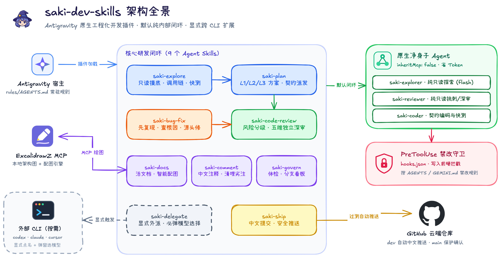

<div align="center">


<h1>Saki Dev Skills</h1>

<p><strong>为 Google Antigravity 打造的原生工程化开发插件与 Agent Skills 套件</strong></p>

<p>
  9 个核心 Agent Skills · 3 个净身原生子 Agent · ExcalidrawZ MCP 智能配图 · PreToolUse 禁改守卫 · 默认纯内部闭环与显式跨 CLI 委托
</p>

<p>
  <strong>简体中文</strong> ·
  <a href="README.en.md">English</a> ·
  <a href="#安装方式">安装方式</a> ·
  <a href="#使用指南">使用指南</a> ·
  <a href="#架构全景">架构全景</a> ·
  <a href="https://github.com/Yuyushu2499/saki-dev-skills/issues">问题反馈 (Issues)</a>
</p>

<p>
  <a href="plugin.json"></a>
  
  
  
  <a href="LICENSE"></a>
  <a href="https://github.com/oil-oil/oil-dev-skills"></a>
</p>

</div>

---

## 架构全景

<p align="center">
  
</p>

<p align="center">
  <sub>使用 ExcalidrawZ MCP 绘制 · 可编辑源文件：<a href="docs/assets/diagrams/system-architecture.excalidraw"><code>docs/assets/diagrams/system-architecture.excalidraw</code></a></sub>
</p>

日常研发默认 **100% 在 Antigravity 内部闭环**（通过内置轻量净身子 Agent `saki-explorer` / `saki-reviewer` / `saki-coder` 完成探索、挑刺、实现、审查与排错，不自动调用外部 CLI）；只有在对话框中**显式要求调用其他 CLI**（如 Codex、Claude Code、Cursor 等）时，才会激活 `saki-delegate`，并在未指明模型时**每次弹出交互式模型选择卡片**（带按任务场景的默认推荐项）。

---

## 套件构成

### 1. 九个核心 Skill（`skills/`）

- **探索 · [`saki-explore`](skills/saki-explore/SKILL.md)**：严格只读的结构盘点与调用链追踪，大仓库默认按独立模块派发 `saki-explorer`（`flash` 模型）并行摸底。
- **方案 · [`saki-plan`](skills/saki-plan/SKILL.md)**：按 `L1 / L2 / L3` 分级制定平实方案，默认由 `saki-reviewer` 独立挑刺，生成带测试与重构建控频红线的派发契约，支持子 Agent 模式与收尾合并清单。
- **审查 · [`saki-code-review`](skills/saki-code-review/SKILL.md)**：先核对方案范围、禁改目录与文件膨胀，再由 `saki-reviewer` 在干净只读上下文执行五维深度审查。
- **排错 · [`saki-bug-fix`](skills/saki-bug-fix/SKILL.md)**：先复现再定位根因，在坏数据源头修复，判断普遍问题并全仓排查，止损时默认开两路 `saki-reviewer` 并行诊断。
- **文档 · [`saki-docs`](skills/saki-docs/SKILL.md)**：遵循“2 核心 + 4 按需”活文档体系（默认中文），支持中途接手项目从真实源码反推生成文档、随功能迭代按 `git diff` 列出影响清单经确认后精准增量同步，以及智能绘图路由（按场景推荐 Mermaid 或本机 ExcalidrawZ MCP 并弹窗确认，支持三级图标配图与扩展其他绘图工具）。
- **注释 · [`saki-comment`](skills/saki-comment/SKILL.md)**：按多语言行业权威规范（Google Python / TSDoc / JSDoc / GoDoc / Rustdoc / Javadoc / Doxygen）为无注释老项目补全函数文档与核心块中文注释（只解释 Why 不复述 What），同时主动扫描清理过期误导、废话、作者日期与大段注释死代码，严格零逻辑改动。
- **交付 · [`saki-ship`](skills/saki-ship/SKILL.md)**：交付前分支保护与敏感文件预检 + 中文提交规范（`Conventional Commits` 前缀 + 中文描述）并推送远端；开发分支测试通过后可直接自动提交推送，`main` / `master` 保护分支必须先确认，也可随时手动调用。
- **治理 · [`saki-govern`](skills/saki-govern/SKILL.md)**：体检并治理 `AGENTS.md` / `GEMINI.md`、`.agents/skills/` 与 `.agents/plugins/`、快慢测试分层、Worktree 卫生，以及支持 Antigravity `generative_ui` 渲染的交互式分支看板。
- **显式跨 CLI 委托 · [`saki-delegate`](skills/saki-delegate/SKILL.md)**：支持 9 种外部 CLI（`claude`、`codex`、`agy`、`cursor`、`opencode`、`workbuddy`、`dsh`、`grok`、`kimi`）。仅在你显式点名外部 CLI 时触发；只要本次未指明模型，每次均通过 `ask_question` 弹出模型选择卡片并给出按任务推荐的默认模型。

### 2. Antigravity 原生增强能力

- **原生 Plugin 清单（[`plugin.json`](plugin.json)）**：可作为单个插件在 Antigravity Customizations 页面一键启停，同时保留标准 `skills/` 结构兼容其他宿主。
- **插件常驻工程规则（[`rules/AGENTS.md`](rules/AGENTS.md)）**：随插件开启自动生效——开发分支测试通过后自动按 `saki-ship` 中文提交推送（保护主分支），日常写代码自动补合理中文注释并顺手清理劣质注释。
- **专用轻量净身子 Agent（`agents/`）**：全部设置 `inheritMcp: false` 剥离无关 MCP 底座 Token 开销：
  - [`saki-explorer`](agents/saki-explorer.md)：纯只读探索子 Agent（无 `edit_file`/`write_file`）。
  - [`saki-reviewer`](agents/saki-reviewer.md)：纯只读独立审查、方案挑刺与高危操作检查子 Agent。
  - [`saki-coder`](agents/saki-coder.md)：严格遵循派发契约与快规则测试节奏的实现子 Agent。
- **禁改目录事前硬拦截（[`hooks.json`](hooks.json) + [`hooks/guard_do_not_edit.py`](hooks/guard_do_not_edit.py)）**：`PreToolUse` 钩子自动读取目标仓库 `AGENTS.md` / `GEMINI.md` / `CLAUDE.md` 中 `saki-dev` 小节的 `禁改`（`do-not-edit`）规则，在 `edit_file` / `write_file` 动手前一瞬间直接拦截越界写入。

---

## 安装方式

### 方式一：作为 Antigravity 原生 Plugin 安装（推荐）

克隆或软链到全局插件目录（或项目 `.agents/plugins/`）：

```bash
# 全局安装（对所有工作区生效）
git clone https://github.com/Yuyushu2499/saki-dev-skills.git ~/.gemini/config/plugins/saki-dev-skills

# 或仅对当前项目生效
git clone https://github.com/Yuyushu2499/saki-dev-skills.git .agents/plugins/saki-dev-skills
```

### 方式二：仅安装标准 `skills/`

```bash
npx skills add Yuyushu2499/saki-dev-skills
```

---

## 使用指南

安装启用后不需要记任何复杂命令，在 Antigravity 对话框里用**自然语言**直接描述需求（或点名对应 Skill）即可。

### 1. 典型研发串联流程

以开发一个跨模块新功能为例，整套套件会自然串联成 5 步闭环：

1. **摸底查代码**：先用 `saki-explore` 只读查清现有调用链、可复用基建与局部快测命令；
2. **写方案并实现**：用 `saki-plan` 出人看得懂的方案（自动由 `saki-reviewer` 挑刺）→ 你确认取舍后按契约编码并跑局部快测；
3. **独立把关**：实现完成后自动衔接 `saki-code-review`，先查越界/禁改/文件膨胀，高风险改动自动开干净只读的 `saki-reviewer` 五维深审；
4. **同步活文档**：合并前经 `saki-docs` 按真实 `git diff` 列出受影响文档清单，你确认后精准增量更新；
5. **中文提交推送**：跑通合并门禁后由 `saki-ship` 安全预检，在开发分支自动中文 `commit + push`（若在 `main` / `master` 保护分支则会先向你确认）。

### 2. 九个 Skill 逐一使用示例

| Skill | 什么时候用 | 直接在对话框里这样说 |
| --- | --- | --- |
| **`saki-explore`** | 接手陌生仓库、定位模块入口、盘点可复用组件与真实快测入口 | `用 saki-explore 梳理这个项目的导出模块调用链，列出可复用组件和局部快测命令。` |
| **`saki-plan`** | 常规功能开发、跨模块重构、审阅现成方案或开启纯决策「子 Agent 模式」 | `我想给时间线加上批量拆分功能，用 saki-plan 写一份看得懂的方案并列出待拍板取舍，先不改代码。`<br>`用 saki-plan 子 Agent 模式推进这个需求：你只做决策，探索、编码和审查全部交给子 Agent。` |
| **`saki-code-review`** | 功能开发/重构/修 Bug 后交付、提交、提 PR 或合并前审查隐患 | `用 saki-code-review 审查当前分支的改动，重点查并发安全、数据兼容和测试质量。` |
| **`saki-bug-fix`** | 遇到原因不明的报错、崩溃、结果不对或偶发失败 | `用 saki-bug-fix 排查：海外用户反馈每日报表里有订单被算到了前一天，先写复现测试再找根因。` |
| **`saki-docs`** | 中途接手项目从源码反推活文档；功能改完按 diff 增量更新；用 ExcalidrawZ / Mermaid 画架构图 | `我刚接手这个仓库，用 saki-docs 通读代码帮我规划并生成 README 和架构文档。`<br>`刚做完这个功能，用 saki-docs 检查本次改动影响了哪些文档并同步更新。`<br>`用 saki-docs 结合 ExcalidrawZ 给这个系统画一张带软件图标的架构全景图。` |
| **`saki-comment`** | 老项目缺少函数/核心逻辑注释需要批量补全；或清理过期误导、废话注释与大段注释死代码 | `用 saki-comment 扫描 src/core 目录，补全缺失的中文函数注释和核心块注释，并清理过期/废话注释和注释掉的死代码，严禁改逻辑。` |
| **`saki-ship`** | 测试通过后自动或手动执行安全预检、生成中文提交信息并推送云端 | `测试已经全通过了，用 saki-ship 帮我检查改动、写中文 commit 并推送到远端。` |
| **`saki-govern`** | 阶段性体检文档死链与 `AGENTS.md` 臃肿、拆分慢测试、生成 `saki-dev` 开发约定或看分支看板 | `用 saki-govern 给我展示这个仓库的分支看板，告诉我每条分支改了什么、该怎么处理。`<br>`用 saki-govern 体检当前仓库的文档、测试分层和 Worktree，并帮我生成 saki-dev 开发约定。` |
| **`saki-delegate`** | **仅需跨工具/跨模型时显式点名外部 CLI**（平时默认纯 Antigravity 闭环；未指明模型时每次必弹模型选择卡片并附推荐项） | `用 codex 独立 review 一下当前分支的高风险改动。`<br>`让 claude 给刚才的方案挑个刺。` |

> **小提示**：日常写代码时，插件内置的 [`rules/AGENTS.md`](rules/AGENTS.md) 会自动生效——新写/修改核心函数会自动附上规范中文注释并清理劣质注释，开发分支测通后会自动按 `saki-ship` 中文提交推送，无需每次手动提醒。

---

## 项目开发约定（`saki-dev`）

在目标仓库根目录的 `AGENTS.md`（或 `GEMINI.md`）中加入标题含 `saki-dev` 的小节：

```markdown
## 开发约定（saki-dev）

- 快测：`pytest tests/{target} -q`
- 门禁：`make ci`
- 高风险：`src/storage/**`、`src/auth/**`、`migrations/`
- 禁改：`vendor/`、`src/generated/**`
```

配置后，`saki-explore`、`saki-plan`、`saki-code-review`、`saki-govern` 与 `PreToolUse` 钩子都会直接读取该约定。详细字段见 [dev-profile.md](skills/saki-govern/references/dev-profile.md)。

## 个人偏好与本地配置

- 个人偏好保存在 `~/.saki-dev/preferences.md`（可用环境变量 `SAKI_DEV_HOME` 覆盖）。
- `saki-delegate` 的状态与运行产物保存在 `~/.saki-delegate`（可用 `SAKI_DELEGATE_HOME` 覆盖，二进制路径可用 `SAKI_DELEGATE_<RUNNER>_BIN` 覆盖）。
- 图标共享仓默认位于 `~/.saki-dev/icons/`，配合 `saki-docs` 的 ExcalidrawZ MCP 绘图与嵌图脚本复用（详见 [diagram-providers.md](skills/saki-docs/references/diagram-providers.md)）。
- 以上配置均仅存本机，不会写入项目仓库。

## 回归测试

无需调用任何模型即可在几秒内跑完全仓单元测试（含插件清单、常驻规则、子 Agent、Hook 拦截与全部 Skill 脚本）：

```bash
python3 scripts/verify_repo.py
```

## 开源协议与致谢

本项目基于 [oil-oil/oil-dev-skills](https://github.com/oil-oil/oil-dev-skills) 进行二次开发，遵循 [MIT License](LICENSE)。
